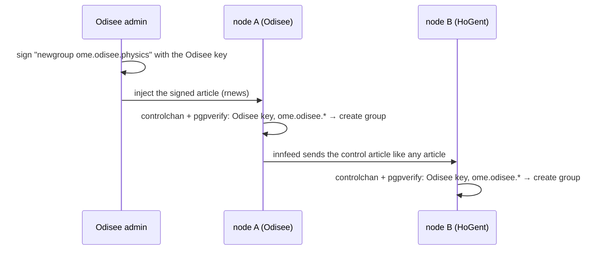

# Spike: signed newgroups per library

Status: spike for the call with Anoop about #310 (how a newsgroup reaches every node).
Nothing here is product code. Tested on 23-11-2026 with two INN 2.7.3 nodes (`tests/peering`).

## Question

When a library creates a newsgroup on its node, how does every other node get it, without a
central service, and without letting anyone else create or remove groups?

## Answer in short

Each library has one PGP key and signs the control articles (`newgroup`, `checkgroups`) for its
**own namespace**, such as `ome.odisee.*`. Every node trusts each library's key **only for that
namespace**. INN already supports this (control articles travel with the normal feed, and
`controlchan` checks them with `pgpverify`); it only needs a few changes in our image and config.



## What the tests prove

`test_signed_newgroups.py`, 9 tests, all green. Each test was also checked to fail when the
thing it guards is broken.

| # | Test | Result | Checked by breaking |
|---|---|---|---|
| 1 | A signed newgroup reaches every peer, with its description (the library's name) | ✅ created on both nodes | without the `HOME` fix (as in the product today) |
| 2 | An unsigned newgroup in a protected namespace | ✅ refused ("pgpverify failed") | a rule without `verify` (`doit`) |
| 3 | Odisee's key for a HoGent group | ✅ refused | Odisee's key trusted for `ome.*`, as the last rule |
| 4 | A key that no node trusts | ✅ refused | |
| 5 | A signed article changed afterwards (other group name) | ✅ refused | `Control` not among the signed headers |
| 6 | An article that reaches a node before its group | ✅ lost for that node, also after the group exists | the group created on node B first |
| 7 | A node that missed a newgroup gets it from a signed `checkgroups` | ✅ created | `checkgroups` not trusted |
| 8 | A signed `rmgroup` | ✅ only mailed to the admin, group kept | `rmgroup` trusted with `verify` |
| 9 | A peer posts an article in another library's group | ⚠️ accepted: articles are not protected | (documents a limit) |

## What we had to change

1. **GnuPG for INN.** Debian builds INN with `gpg=/usr/bin/gpg1`, and `pgpverify` prefers it over
   `gpgv`, so the image needs `gnupg1` (the package Debian suggests for `inn2`). GnuPG 1.4 has no
   Ed25519: the keys are RSA 3072.
2. **`HOME` for innd.** The entrypoint starts innd with `HOME=/root`. `pgpverify` runs `gpg1` as
   user `news`, which cannot create `/root/.gnupg`, so **every** check fails. Today
   `pgpverify: true` in `inn.conf` cannot work at all. Fix: start innd with the home of `news`.
3. **Trusted keys** in `/etc/news/pgp/pubring.gpg`, owned by root and readable by `news`: only the
   admin can change who is trusted.
4. **Rules** in `control.ctl.local`, one line per library and action:
   `newgroup:*:ome.odisee.*:verify-ome-control-odisee` and the same for `checkgroups`.
   `rmgroup` keeps INN's default (`mail`).
5. **A signer without questions**, `ome_control.py`: same format as Julien Élie's `signcontrol`
   (INN's maintainer), but it asks nothing, calls `gpg` without a shell, and never puts a
   passphrase on the command line. INN's `pgpverify` accepts its articles.

## Findings

1. `control.ctl` uses the **last matching rule**. A broad rule placed last (`ome.*`) silently
   overrides the namespace rules: the rule order is a security setting.
2. An article refused because its group does not exist is **remembered** (`remembertrash`, history
   says `/dev/null`): when the group exists later, the article is refused as a duplicate.
3. Every newgroup makes innd restart `controlchan` and `innfeed` (seen in the logs). That also
   writes innfeed's buffered backlog to disk (related to bug #308).
4. A control article cannot be posted with `inews` ("ask your news administrator"): the admin
   injects it with `rnews`, as a peer would.
5. The image runs no syslog daemon: innd, controlchan and pgpverify log nothing we can read.
   The tests start a small listener (`syslog_to_file.py`); see also #294.

## Your six points, checked

| Point | Verdict | How to handle it |
|---|---|---|
| 1. A node that joins later misses the groups | True | A signed `checkgroups` per namespace, posted again regularly (test 7), or `actsync` once at the first start |
| 2. The order matters: group first, then articles | True, and worse: the early article is remembered as refused (test 6) | Create the group before the first article; the installer sends the newgroup first and waits |
| 3. Key management, central or not | True | One key per library, valid in its own namespace only: no central maintainer |
| 4. Revoking a key means work on every node | True | One command per node (`ome-node peer remove`, or Ansible); no automatic revocation |
| 5. Articles are not protected | True (test 9) | Later: per-peer group patterns in `incoming.conf`, or signed articles |
| 6. `rmgroup` is dangerous | True | `rmgroup` only mails the admin, even with a valid signature (test 8) |

## Compared with the other options

| | Signed newgroups (this spike) | Anoop's sync script (`preseed.sh`) | `ome.announce` channel |
|---|---|---|---|
| New group reaches running nodes | Yes, in seconds | Only when the script runs | Only if the node subscribes and acts on it |
| New node gets existing groups | With `checkgroups` | Yes, at the first start | Must read the whole channel |
| Who may create groups | Only the owner of the namespace | Anyone a peer carries | Anyone who can post |
| Articles of old groups | Normal feed | `pullnews` pulls them (a pull) | Normal feed |
| Central part | None | None | The channel and its moderation |
| Work | Keys per library, rules per node | Run the script; needs `peers[].port` | Admin work (Anoop) |

## What a product version would need

1. `gnupg1` in `Dockerfile-nntp`, and innd started with `HOME` set to the home of `news`.
2. `control.ctl.local` generated from `config.json`: for each peer, its key ID and its namespace.
3. In the installer: create the library's key, `ome-node newgroup <name> <description>` (signs and
   injects), `ome-node peer add` also pins the peer's PGP key, and a regular signed `checkgroups`.
4. A test like this one in the peering CI job.

## Open questions for Anoop

1. One key per library with its own namespace (`ome.odisee.*`), or one key for all of `ome.*`?
2. Should a new node also run `actsync` once, or is `checkgroups` enough?
3. Where do the logo and the contact of a library come from? The newgroup only carries a one-line
   description.
4. Are unprotected articles (point 5) acceptable for now?

## Run it

From the root of the repository, with Docker and GnuPG on the machine:

```sh
uv run pytest spike/signed_newgroups -m peering -v
```

The test builds the NNTP image, starts two nodes (project `ome-spike-signed-newgroups`), creates
throw-away keys for Odisee, HoGent and an unknown signer, and removes everything at the end.

| File | What it is |
|---|---|
| `Dockerfile` | The NNTP image plus `gnupg1`, and the trusted-keys folder |
| `compose.yaml` | Puts the two test nodes on that image and sets `HOME` |
| `ome_control.py` | Builds and signs `newgroup`, `rmgroup` and `checkgroups` articles |
| `syslog_to_file.py` | Keeps INN's syslog messages, for the tests |
| `test_signed_newgroups.py` | The 9 tests above |
